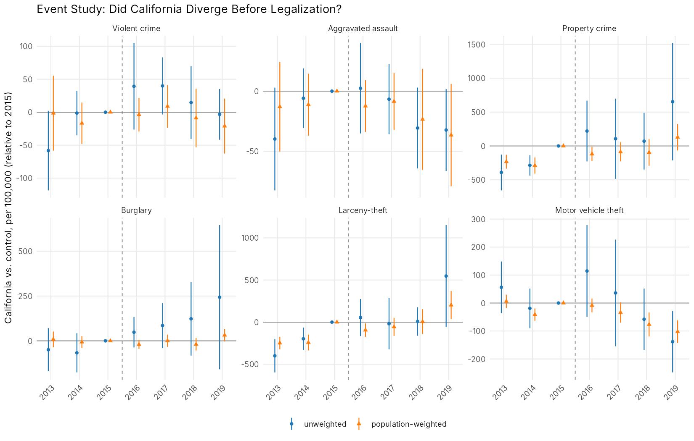

# Recreational Marijuana Legalization and Crime: Evidence from California

Did California's 2016 legalization of recreational marijuana (Proposition 64) increase crime? This economics honors thesis compares California cities with cities in Idaho, Kansas, South Carolina, and Wyoming, which allowed neither medical nor recreational marijuana, over 2013–2019 using a two-way fixed-effects difference-in-differences design and FBI Uniform Crime Reporting data.

**Thesis tools:** Python, Stata · **Public pipeline:** R (fixest, dplyr, ggplot2), Python (pandas, pyfixest)

**Date:** Economics Honors Thesis, University of California, Irvine, September 2024 – June 2025

**Paper:** [`paper/Faye_Wu_Marijuana_Legalization_Crime_Thesis.pdf`](paper/Faye_Wu_Marijuana_Legalization_Crime_Thesis.pdf)

## What I Did

- **Built the analysis panel.** Reduced data loss 20% by cleaning, merging, and standardizing 600+ source datasets (FBI UCR city crime workbooks, BLS county unemployment, ACS county income) in Python and Stata into a city-year panel with harmonized policy-timing and outcome variables; the thesis analysis reports 5,678 city-year observations.
- **Estimated the causal effect.** Tested whether legalization increased crime with a two-way fixed-effects difference-in-differences model with city and year fixed effects, then added population, unemployment, and income controls to check how sensitive the estimates were.
- **Owned the project end-to-end.** Presented progress to faculty advisors twice a week, wrote the departmental honors thesis, and presented it to 300+ attendees at the 2025 Undergraduate Research Symposium, translating the results into implications for regulation and law-enforcement policy.

## Thesis Findings

| Outcome | Finding in the submitted thesis |
|---|---|
| Violent crime | No statistically significant effect of legalization |
| Property crime | Adding economic controls cut the estimate by about two-thirds, pointing to upward bias in unadjusted estimates |
| Larceny-theft | Only weak evidence of an increase (p = 0.09) |
| Overall | No support for a large increase in crime after legalization |

The thesis also flagged Proposition 47 (2014), which reduced penalties for theft under $950, as a likely confounder and proposed an event study, a timing split, and population weighting as extensions.

## Reproducibility Note

After submission, I rewrote the analysis as public, reproducible code in R, with an independent Python implementation. Building it from the raw spreadsheets corrected how county controls are matched to cities and how rates are labeled, so some estimates here differ from the PDF ([`R/02_audit_original_data.R`](R/02_audit_original_data.R), [`audit_checks.csv`](outputs/tables/audit_checks.csv)). The main conclusion is unchanged: there is no effect on violent crime in any specification and no support for a large increase in crime. With correctly merged controls, the property-crime estimate does not fall; the event study the thesis proposed shows California's property-crime and larceny gap opened between 2013 and 2015, before legalization and in line with Proposition 47.



### Estimates from the public pipeline

Two-way fixed-effects difference-in-differences, offenses per 100,000 residents. Standard errors clustered by city; p-values in parentheses.

| Specification | Violent crime | Property crime | Larceny-theft |
|---|---|---|---|
| (1) City and year FE, 2013–2019 | 43.1 (0.10) | 485.4 (0.04) | 343.2 (0.00) |
| (2) City and year FE, 2014–2019 | 22.8 (0.23) | 406.9 (0.10) | 247.1 (0.03) |
| (3) + population, county unemployment | 7.6 (0.69) | 416.7 (0.10) | 276.3 (0.04) |
| (4) + county income proxy (excl. Kansas) | 8.5 (0.69) | 518.3 (0.09) | 338.6 (0.02) |
| (5) City and year FE, population-weighted | −0.5 (0.99) | 121.5 (0.12) | 170.0 (0.00) |

Specifications (2)–(4) start in 2014 because the county unemployment files begin that year. All six outcomes, standard errors, and sample sizes are in [`outputs/tables/table3_did_estimates.csv`](outputs/tables/table3_did_estimates.csv). With one treated state, city-clustered p-values likely overstate precision (Conley & Taber, 2011).

## Repository Structure

```
├── paper/                              # submitted thesis (PDF)
├── R/                                  # main pipeline
│   ├── 00_setup.R                      # packages, paths, constants
│   ├── 01_build_panel.R                # clean, merge by name, compute rates
│   ├── 02_audit_original_data.R        # checks on the original spreadsheets
│   ├── 03_analysis.R                   # tables, event study, figures
│   └── run_all.R                       # rebuilds everything
├── python/                             # independent implementation of the same pipeline
├── data/
│   ├── raw/
│   │   ├── ucr_city_workbooks/         # FBI UCR city crime counts, one sheet per year
│   │   ├── laus_county_unemployment/   # BLS county unemployment rates (via FRED)
│   │   ├── acs_s1903_ccd/              # ACS median income by county subdivision
│   │   └── original_covariate_lists/   # lists used to fill the original covariate columns (audit only)
│   ├── external/city_county_crosswalk.csv
│   └── processed/city_year_panel.csv   # generated analysis panel
└── outputs/
    ├── tables/
    └── figures/
```

## How to Run

**R (main pipeline):**

```r
install.packages(c("dplyr", "tidyr", "readr", "readxl", "stringr", "purrr", "fixest", "ggplot2"))
```

```bash
Rscript R/run_all.R
```

**Python (cross-check):** the `python/` folder implements the same pipeline with pandas and pyfixest and produces identical estimates. It writes to `outputs/python/` so the two never overwrite each other.

```bash
pip install -r requirements.txt
python python/run_all.py
```

`python/make_crosswalk.py` builds the city-to-county crosswalk. It downloads its source list, so it is not part of either `run_all` script; its output is committed.

## Data Sources

- **Crime and population:** FBI Uniform Crime Reporting Program, *Crime in the United States*, offenses known to law enforcement by city, 2013–2019.
- **Unemployment:** U.S. Bureau of Labor Statistics, Local Area Unemployment Statistics, annual county rates (downloaded from FRED), 2014–2020.
- **Income:** U.S. Census Bureau, American Community Survey 5-year estimates, table S1903, median household income for householders aged 25–44, by county subdivision. These are aggregated to a household-weighted county proxy; no files are available for Kansas or for California in 2013.
- **City-to-county crosswalk:** derived from the public [USA-cities-and-states](https://github.com/grammakov/USA-cities-and-states) list, with 29 cities assigned by hand to their principal county.

## Limitations

- One treated state and four control states make inference fragile; synthetic control or randomization inference would be stronger tests.
- Covariates are measured at the county level, and the income measure is a proxy.
- Only three pre-legalization years are available, and 2013 lacks unemployment data.
- UCR participation is voluntary, so the panel is unbalanced and recorded crime can change with reporting practices.
